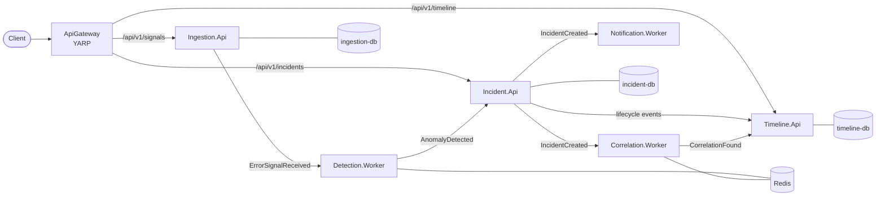

# IncidentFlow

An event-driven incident response platform built on .NET 8 and .NET Aspire. It turns raw production
signals — errors, logs, metrics, deployments, health checks — into detected anomalies, correlated
failure groups, incidents with a lifecycle, notifications, and an append-only timeline.

The system is a set of independently deployable services communicating over RabbitMQ, with
per-service PostgreSQL databases, Redis for time-windowed detection state, a YARP gateway at the
edge, and OpenTelemetry throughout.

## Architecture



All inter-service communication is asynchronous via MassTransit over RabbitMQ. No service calls
another over HTTP; the only synchronous hop is the gateway proxying client requests inward.

### Services

| Project | Responsibility | State |
|---|---|---|
| `src/IncidentFlow.ApiGateway` | Edge: YARP reverse proxy, correlation ID, API key guard | — |
| `src/Services/…Ingestion.Api` | Accepts signals, persists them, publishes signal events, idempotency | `ingestion-db` |
| `src/Services/…Detection.Worker` | Redis sliding-window spike detection, publishes `AnomalyDetected` | Redis |
| `src/Services/…Correlation.Worker` | Groups incidents by deployment and by fingerprint | Redis |
| `src/Services/…Incident.Api` | Incident aggregate, dedupe, lifecycle endpoints, lifecycle events | `incident-db` |
| `src/Services/…Notification.Worker` | Consumes `IncidentCreated`, dispatches notifications | — |
| `src/Services/…Timeline.Api` | Append-only event log across the whole workflow | `timeline-db` |
| `src/IncidentFlow.BuildingBlocks` | Shared integration event contracts and `IEventBus` | — |
| `src/IncidentFlow.ServiceDefaults` | OpenTelemetry, health endpoints, HTTP resilience, service discovery | — |
| `src/IncidentFlow.AppHost` | Aspire orchestration of all services and backing containers | — |

### Detection and correlation

Detection uses a Redis sorted set per `service:environment:fingerprint`. Every signal is added with
its timestamp as the score, entries outside the window are trimmed, and the remaining count is the
spike count — **5 errors within 5 minutes** fires `AnomalyDetected` and resets the window. Keeping
the window in Redis rather than in process memory means detection survives worker restarts and has
no cold-start race.

Correlation runs two independent 10-minute windows over created incidents, each with a threshold of
2: `corr:deploy:{env}:{deploymentId}` catches deployment regressions, and
`corr:fingerprint:{env}:{fingerprint}` catches one fault spreading across services. Windows are
keyed per environment, so staging noise never correlates with production.

## Getting started

### Prerequisites

- .NET 8 SDK
- The Aspire workload: `dotnet workload install aspire`
- Docker — Aspire starts PostgreSQL, Redis, and RabbitMQ as containers, and the integration tests
  use Testcontainers

### Run

```bash
dotnet run --project src/IncidentFlow.AppHost
```

The Aspire dashboard lists every service with its endpoints, logs, traces, and metrics. PgAdmin,
Redis Commander, and the RabbitMQ management plugin are started alongside the infrastructure.

### Database migrations

Each PostgreSQL-backed service owns its own migrations and ships an `IDesignTimeDbContextFactory`,
so `dotnet-ef` works without the Aspire host running:

```bash
dotnet tool restore
dotnet ef database update --project src/Services/IncidentFlow.Services.Ingestion.Api
dotnet ef database update --project src/Services/IncidentFlow.Services.Incident.Api
dotnet ef database update --project src/Services/IncidentFlow.Services.Timeline.Api
```

### Tests

```bash
dotnet test tests/IncidentFlow.IntegrationTests   # requires Docker
dotnet run  --project tests/IncidentFlow.SmokeTests
dotnet run  --project tests/IncidentFlow.ContractTests
```

`IntegrationTests` (xUnit, Testcontainers, FluentAssertions) exercises the spike detector and
correlation engine against a real Redis instance, and the ingestion endpoints against a real
PostgreSQL instance through `WebApplicationFactory`.

## API

All routes are served through the gateway. Set `INCIDENTFLOW_API_KEY` to require an `x-api-key`
header on everything except `/` and `/health/*`. An `x-correlation-id` header is honoured if
supplied and echoed back otherwise.

**Ingestion** — `Ingestion.Api`

```http
POST /api/v1/signals/errors
POST /api/v1/signals/logs
POST /api/v1/signals/metrics
POST /api/v1/signals/deployments
POST /api/v1/signals/health-checks
GET  /api/v1/signals
```

Signals accept an idempotency key; a repeat returns the original `signalId` with `duplicate: true`.

**Incidents** — `Incident.Api`

```http
GET  /api/v1/incidents
GET  /api/v1/incidents/open
GET  /api/v1/incidents/{id}
POST /api/v1/incidents/{id}/acknowledge
POST /api/v1/incidents/{id}/resolve
POST /api/v1/incidents/{id}/close
```

Incoming anomalies are deduplicated against currently open incidents by service, environment, and
fingerprint, so a sustained fault produces one incident rather than a stream of them.

**Timeline** — `Timeline.Api`

```http
GET /api/v1/timeline/incidents/{incidentId}
GET /api/v1/timeline/correlation/{correlationId}
```

**Operational** — every service exposes `/health/live` and `/health/ready` via ServiceDefaults.

## Integration events

Defined in `IncidentFlow.BuildingBlocks`, all wrapped in a common `IntegrationEvent` envelope:

`ErrorSignalReceived` · `LogSignalReceived` · `MetricSignalReceived` · `DeploymentSignalReceived` ·
`HealthCheckSignalReceived` · `AnomalyDetected` · `CorrelationFound` · `IncidentCreated` ·
`IncidentAcknowledged` · `IncidentResolved` · `IncidentClosed`

## Project status

The distributed system described above is implemented and builds clean. Some surface still comes
from `IncidentFlow.Core`, the original single-process prototype the project started as, which the
gateway hosts in memory alongside the proxy:

```http
GET  /api/v1/reports/*          # summary, mtta, mttr, severity, top-failing, regressions
GET  /api/v1/events{,/outbox,/inbox}
POST /api/v1/notifications/retry-failed
GET  /api/v1/runtime/readiness
```

These read the prototype's in-memory stores, which the extracted services no longer feed — the
reporting and postmortem capabilities have not been migrated onto the service databases yet.
Ingestion of traces and user reports, and the assign / escalate / reopen lifecycle commands, exist
in the prototype but not yet in `Incident.Api`. Reporting projections, recommendations, and
postmortems are the next migration step; identity and an operator UI come after.

`SmokeTests` and `ContractTests` exercise the prototype engine; `IntegrationTests` covers the
services.

## Documentation

| Document | Contents |
|---|---|
| `docs/architecture/overview.md` | Architecture, runtime profiles, core boundaries |
| `docs/architecture/service-boundaries.md` | Service responsibilities and state ownership |
| `docs/architecture/event-flow.md` | Event workflow and adapter mapping |
| `docs/architecture/reliability.md` | Idempotency, outbox/inbox, rate limiting, observability |
| `docs/api/events.md` | Event envelope and event catalogue |
| `docs/api/http-api.md` | HTTP endpoint reference |
| `docs/demos/payment-regression.md` | Demo walkthrough |
| `docs/diagrams/incidentflow-diagrams.md` | System, container, event, and sequence diagrams |

> Parts of `docs/` predate the microservices split and still describe the single-process prototype.

## Stack

.NET 8 · ASP.NET Core Minimal APIs · .NET Aspire 8.2.2 · YARP 2.2 · MassTransit 8.3 / RabbitMQ ·
PostgreSQL + EF Core 8 · Redis (StackExchange.Redis) · OpenTelemetry 1.11 · xUnit · Testcontainers ·
FluentAssertions
