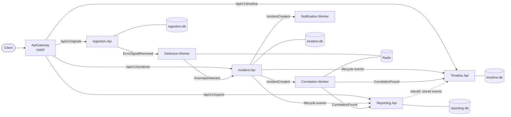

# IncidentFlow

An event-driven incident response platform built on .NET 8 and .NET Aspire. It turns raw production
signals — errors, logs, metrics, deployments, health checks — into detected anomalies, correlated
failure groups, incidents with a lifecycle, notifications, an append-only timeline, and incident
reports (MTTA, MTTR, severity, failing services, deployment regressions).

The system is a set of independently deployable services communicating over RabbitMQ, with
per-service PostgreSQL databases, Redis for time-windowed detection state, a YARP gateway at the
edge, and OpenTelemetry throughout.

## Architecture



All inter-service communication is asynchronous via MassTransit over RabbitMQ, with one exception:
a report rebuild, on request, reads Timeline's stored events over HTTP. Otherwise the only synchronous
hop is the gateway proxying client requests inward.

### Services

| Project | Responsibility | State |
|---|---|---|
| `src/IncidentFlow.ApiGateway` | Edge: YARP reverse proxy, correlation ID, API key guard | — |
| `src/Services/…Ingestion.Api` | Accepts signals, persists them, publishes signal events, idempotency | `ingestion-db` |
| `src/Services/…Detection.Worker` | Redis sliding-window spike detection, publishes `AnomalyDetected` | Redis |
| `src/Services/…Correlation.Worker` | Groups incidents by deployment and by fingerprint | Redis |
| `src/Services/…Incident.Api` | Incident aggregate, dedupe, lifecycle endpoints, lifecycle events | `incident-db` |
| `src/Services/…Notification.Worker` | Consumes `IncidentCreated`, dispatches notifications | — |
| `src/Services/…Timeline.Api` | Append-only event log across the whole workflow | `timeline-db` |
| `src/Services/…Reporting.Api` | Incident read model from lifecycle and correlation events; report endpoints | `reporting-db` |
| `src/IncidentFlow.BuildingBlocks` | Shared integration event contracts and `IEventBus` | — |
| `src/IncidentFlow.ServiceDefaults` | OpenTelemetry, health endpoints, HTTP resilience, service discovery | — |
| `src/IncidentFlow.AppHost` | Aspire orchestration of all services and backing containers | — |

### Detection and correlation

Detection uses a Redis sorted set per `service:environment:fingerprint`. Every signal is added with
its timestamp as the score, entries outside the window are trimmed, and the remaining count is the
spike count — **5 errors within 5 minutes** fires `AnomalyDetected` and resets the window. Keeping
the window in Redis rather than in process memory means detection survives worker restarts and has
no cold-start race.

Correlation runs two independent 10-minute windows over created incidents, each with a threshold of
2: `corr:deploy:{env}:{deploymentId}` catches deployment regressions, and
`corr:fingerprint:{env}:{fingerprint}` catches one fault spreading across services. Windows are
keyed per environment, so staging noise never correlates with production.

## Getting started

### Prerequisites

- .NET 8 SDK
- The Aspire workload: `dotnet workload install aspire`
- Docker — Aspire starts PostgreSQL, Redis, and RabbitMQ as containers, and the integration tests
  use Testcontainers

### Run

```bash
dotnet run --project src/IncidentFlow.AppHost
```

The Aspire dashboard lists every service with its endpoints, logs, traces, and metrics. PgAdmin,
Redis Commander, and the RabbitMQ management plugin are started alongside the infrastructure.

### Database migrations

Each PostgreSQL-backed service owns its own migrations and ships an `IDesignTimeDbContextFactory`,
so `dotnet-ef` works without the Aspire host running:

```bash
dotnet tool restore
dotnet ef database update --project src/Services/IncidentFlow.Services.Ingestion.Api
dotnet ef database update --project src/Services/IncidentFlow.Services.Incident.Api
dotnet ef database update --project src/Services/IncidentFlow.Services.Timeline.Api
dotnet ef database update --project src/Services/IncidentFlow.Services.Reporting.Api
```

### Tests

```bash
dotnet test tests/IncidentFlow.UnitTests
dotnet test tests/IncidentFlow.IntegrationTests   # requires Docker
dotnet test tests/IncidentFlow.Specs              # requires Docker (Redis)
dotnet test tests/IncidentFlow.Contracts.Tests
```

- `UnitTests`: the Incident aggregate, the Slack notifier, messaging defaults and tracing setup.
- `IntegrationTests` (xUnit, Testcontainers, FluentAssertions): the services against real PostgreSQL and
  Redis through `WebApplicationFactory` and the MassTransit test harness, including the outbox, inbox,
  duplicate-incident and Slack dedupe behaviour, the migration over existing duplicates, worker health
  endpoints, rate limiting, and the gateway (through YARP to stub services): the correlation id, every
  `/api/v1/reports/*` route reaching Reporting, and the retired prototype routes answering 404.
- `Specs` (Reqnroll): plain-language scenarios for the incident lifecycle, the detection threshold and the
  per-source rate limit.
- `Contracts.Tests`: pins the JSON shape of every integration event, so a renamed or removed field fails.

GitHub Actions (`.github/workflows/ci.yml`) runs on every push and pull request: it installs the Aspire
workload, builds the solution in Release, runs `dotnet test` on the solution (UnitTests, IntegrationTests,
Specs, Contracts.Tests; results uploaded as .trx files). The SDK comes from `global.json` (8.0.400 or a
later 8.0 feature band).
Design decisions are recorded in [`docs/adr/`](docs/adr/README.md).

## API

All routes are served through the gateway. Set `INCIDENTFLOW_API_KEY` to require an `x-api-key`
header on everything except `/` and `/health/*`. An `x-correlation-id` header is honoured if
supplied and echoed back otherwise.

**Ingestion** — `Ingestion.Api`

```http
POST /api/v1/signals/errors
POST /api/v1/signals/logs
POST /api/v1/signals/metrics
POST /api/v1/signals/deployments
POST /api/v1/signals/health-checks
GET  /api/v1/signals
```

Signals accept an idempotency key; a repeat returns the original `signalId` with `duplicate: true`.

**Incidents** — `Incident.Api`

```http
GET  /api/v1/incidents
GET  /api/v1/incidents/open
GET  /api/v1/incidents/{id}
POST /api/v1/incidents/{id}/acknowledge
POST /api/v1/incidents/{id}/resolve
POST /api/v1/incidents/{id}/close
```

Incoming anomalies are deduplicated against currently open incidents by service, environment, and
fingerprint, so a sustained fault produces one incident rather than a stream of them. A partial unique
index on that key (while the incident is open or acknowledged) keeps two anomalies arriving at the same
moment from opening two incidents; the one that loses is treated as already open.

**Timeline** — `Timeline.Api`

```http
GET /api/v1/timeline/incidents/{incidentId}
GET /api/v1/timeline/correlation/{correlationId}
GET /api/v1/timeline/events?after={cursor}&take={n}
```

`/events` pages through every stored event in order (event type, payload JSON, recorded time, and the
cursor for the next page); Reporting's rebuild replays it. `take` defaults to 100 and is capped at 500;
pass the returned `nextCursor` as `after` for the next page, and an empty page means the end. A negative
`after` or a `take` below 1 returns 400.

**Reporting** — `Reporting.Api`

```http
GET  /api/v1/reports/summary
GET  /api/v1/reports/mtta
GET  /api/v1/reports/mttr
GET  /api/v1/reports/severity-breakdown
GET  /api/v1/reports/top-failing-services
GET  /api/v1/reports/service-reliability
GET  /api/v1/reports/deployment-regressions
POST /api/v1/reports/rebuild[?clean=true]
```

Every report takes optional `serviceName` and `environment` filters. The figures come from Reporting's
own read model, one row per incident built from `IncidentCreated`, `IncidentAcknowledged`,
`IncidentResolved` and `IncidentClosed`; incidents named by a deployment `CorrelationFound` count as
deployment regressions. MTTA and MTTR are mean minutes from detection to acknowledgement and to
resolution. `rebuild` replays the events Timeline has stored through the same projection, committing a page
at a time, and returns the summary. By default it deletes nothing, so incidents Reporting has consumed but
Timeline has not stored yet are kept; `clean=true` empties the read model first and should only be run once
Timeline has caught up (figures are partial while it runs). A second rebuild while one is running returns 409.
See ADR 0008.

**Operational** — every service, the three workers included, exposes `/health/live` and
`/health/ready` via ServiceDefaults. Traces include MassTransit's publish and consume spans, so a
request can be followed across RabbitMQ in the Aspire dashboard.

## Integration events

Defined in `IncidentFlow.BuildingBlocks`:

`ErrorSignalReceived` · `LogSignalReceived` · `MetricSignalReceived` · `DeploymentSignalReceived` ·
`HealthCheckSignalReceived` · `AnomalyDetected` · `CorrelationFound` · `IncidentCreated` ·
`IncidentAcknowledged` · `IncidentResolved` · `IncidentClosed`

Each one travels in MassTransit's envelope (`MessageId`, `CorrelationId`, `ConversationId`,
`SentTime`, `MessageType`). Every payload also carries the business `CorrelationId` that started at
the signal's HTTP request (`x-correlation-id`); a publish filter copies it into the envelope's
`CorrelationId` when it is a GUID.

Delivery:

- **Outbox** — Ingestion and Incident save an entity and its event in one transaction (MassTransit's
  Entity Framework outbox); the event is delivered after the commit, so a crash in between loses nothing.
- **Inbox** — Incident's and Timeline's consumers record each `MessageId` in the same transaction as
  their write, so a redelivered message is skipped.
- **Workers without a database** — Detection and Correlation use the in-memory outbox: a consumer's
  publishes go out only if it succeeds. Notification remembers posted `MessageId`s in Redis for 24 hours,
  so a redelivery never posts to Slack twice.
- Failed messages are retried after 200 ms, 1 s and 5 s, then moved to the queue's `_error` queue.

## Project status

The services above are the whole system: the gateway serves no routes of its own beyond `/` and the
health endpoints, and proxies everything else. The single-process prototype the project started as
(`IncidentFlow.Core`, with its console smoke and contract runners) has been retired and removed.

Not built yet:

- Postmortems.
- Recommendations.
- Ingestion of traces and user reports.
- The assign, escalate and reopen lifecycle commands (`Incident.Api` has acknowledge, resolve and close).
- Identity (the gateway's API key stands in for it) and an operator UI.

## Documentation

| Document | Contents |
|---|---|
| `docs/architecture/overview.md` | Architecture, runtime profiles, core boundaries |
| `docs/architecture/service-boundaries.md` | Service responsibilities and state ownership |
| `docs/architecture/event-flow.md` | Event workflow and adapter mapping |
| `docs/architecture/reliability.md` | Idempotency, outbox/inbox, rate limiting, observability |
| `docs/api/events.md` | Event envelope and event catalogue |
| `docs/api/http-api.md` | HTTP endpoint reference |
| `docs/demos/payment-regression.md` | Demo walkthrough |
| `docs/diagrams/incidentflow-diagrams.md` | System, container, event, and sequence diagrams |

> Parts of `docs/` predate the microservices split and still describe the retired single-process
> prototype: `docs/api/http-api.md` lists its routes (postmortems, recommendations, events, readiness), and
> the demo walkthrough runs the removed smoke runner. This README and `docs/adr/` describe what runs.

## Stack

.NET 8 · ASP.NET Core Minimal APIs · .NET Aspire 8.2.2 · YARP 2.2 · MassTransit 8.3 / RabbitMQ ·
PostgreSQL + EF Core 8 · Redis (StackExchange.Redis) · OpenTelemetry 1.11 · xUnit · Testcontainers ·
FluentAssertions · Reqnroll
