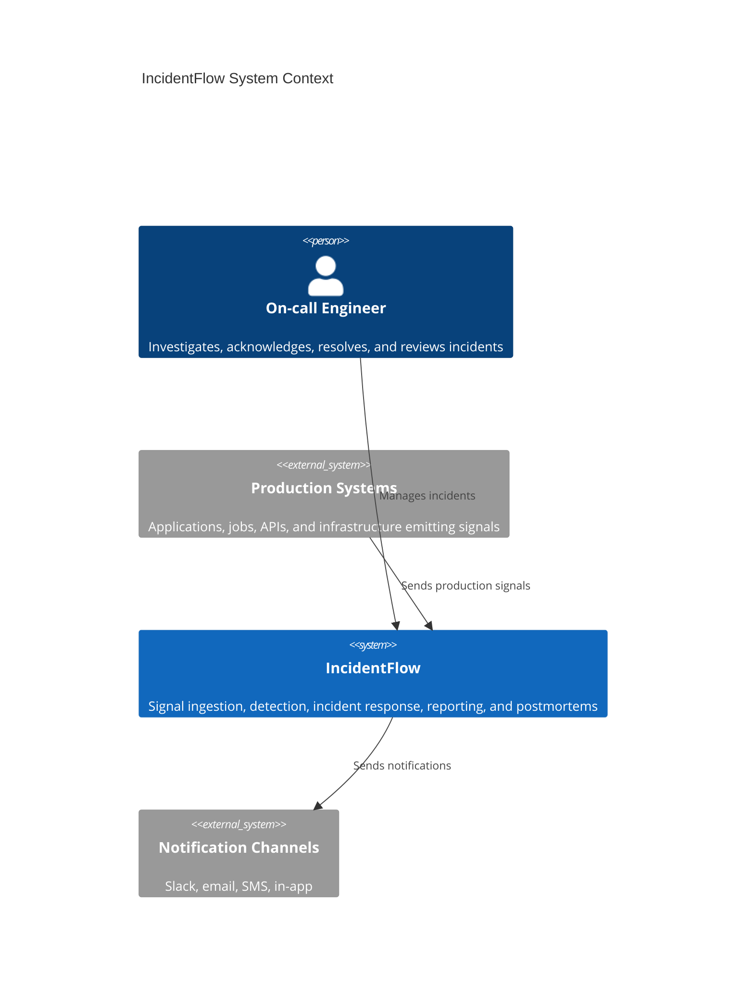
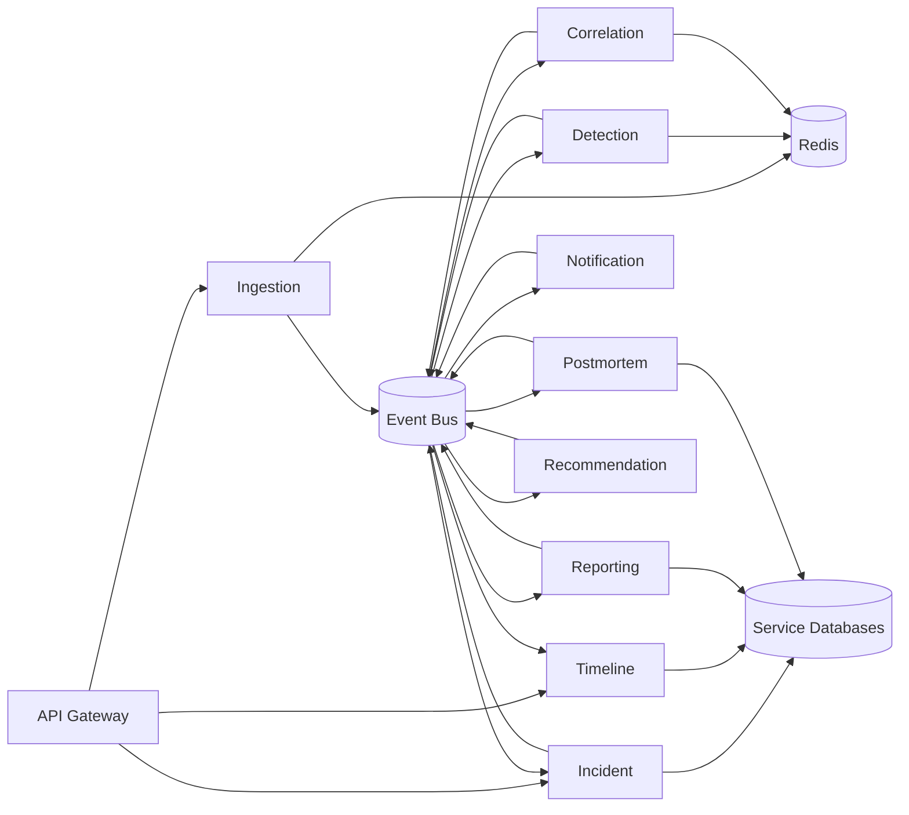
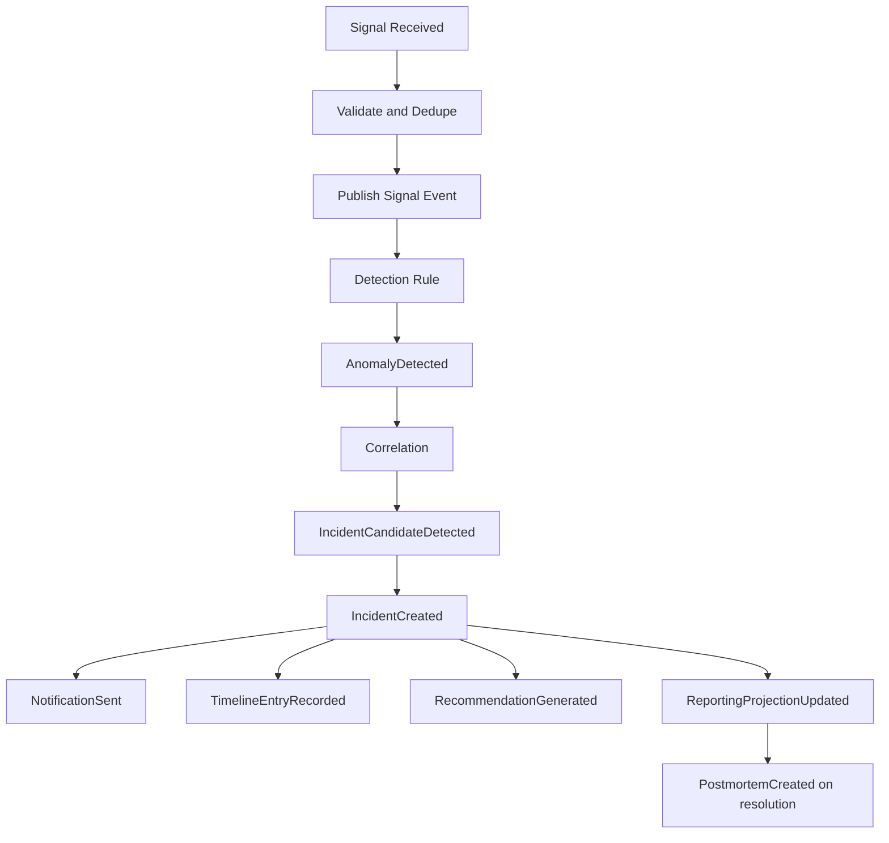
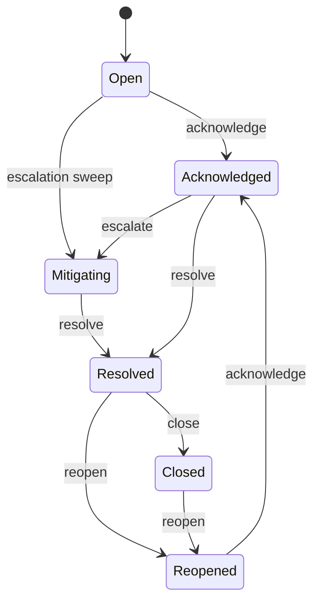
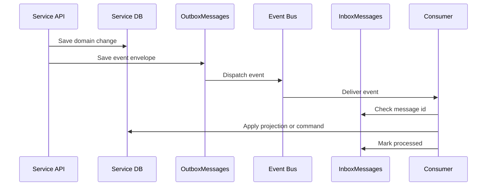
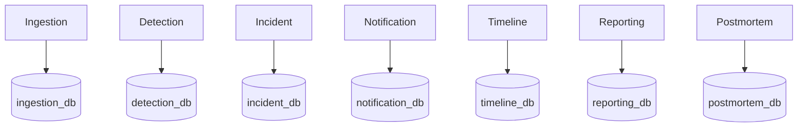
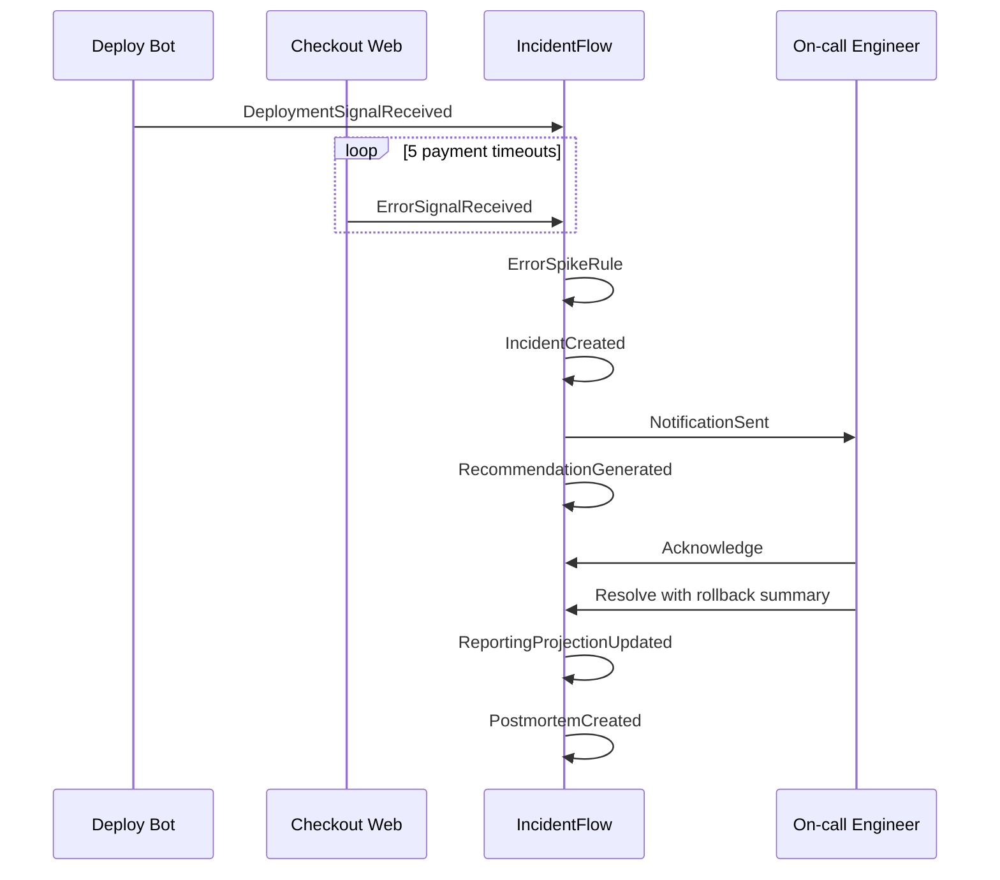

> This document describes the retired single-process prototype. For what runs today see the README and docs/adr.

# IncidentFlow Diagrams

## System Context

## Container Diagram

## Event Flow

## Incident Lifecycle

## Outbox And Inbox Reliability

## Data Ownership

## Payment Regression Sequence

